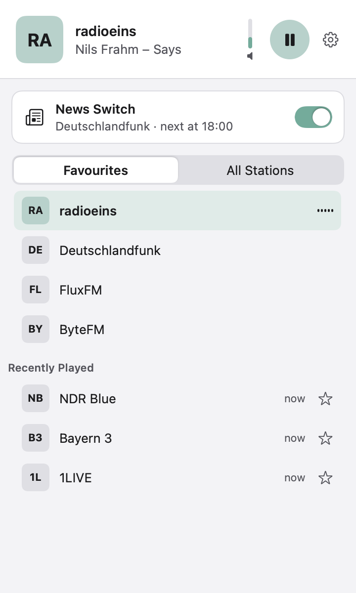
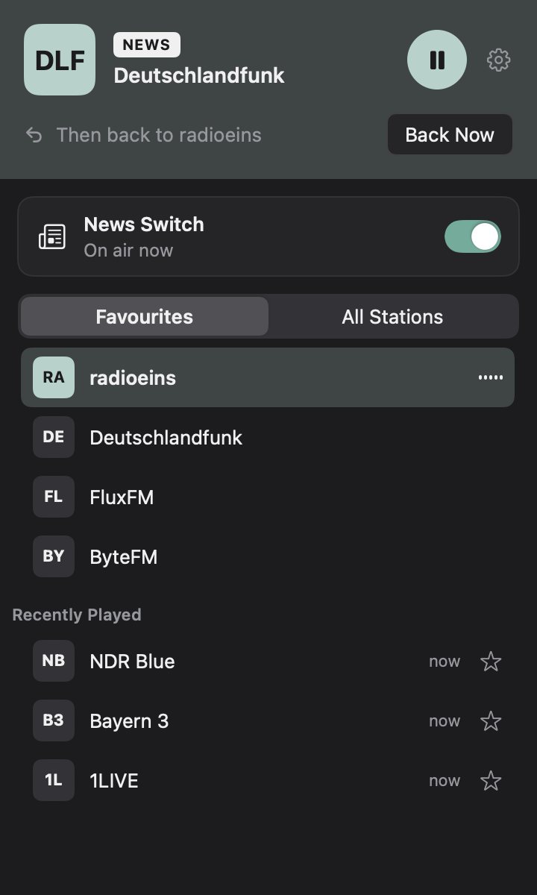
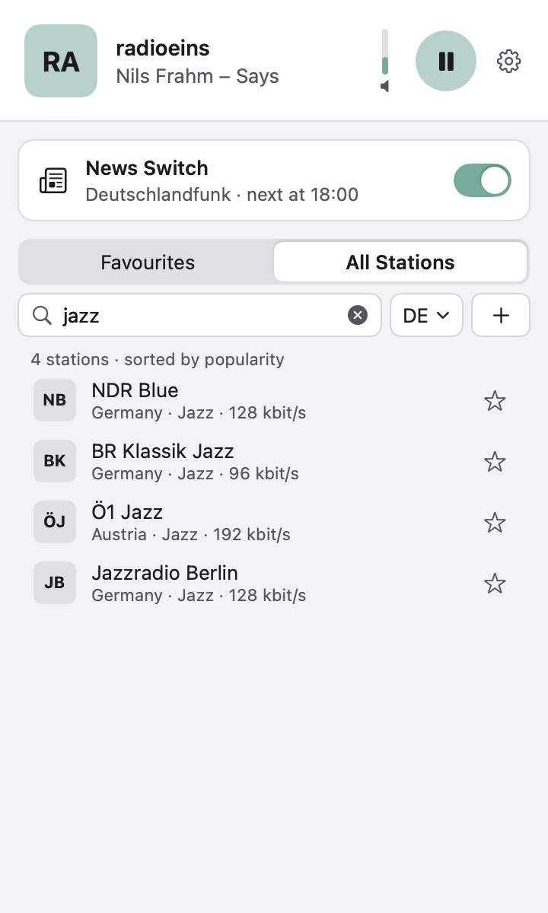

<h1 align="center">&nbsp;&nbsp;FONA</h1>

<p align="center"><code>menu bar app</code>&nbsp;&nbsp;<code>macOS 14+</code>&nbsp;&nbsp;<code>free · GPL-3.0</code></p>

<p align="center">☕ If you use Fona and like it, I would be glad if you <a href="https://buymeacoffee.com/moritzpoth">bought me a coffee</a>.</p>

Internet radio in your Mac's menu bar – with an automatic switch to the Deutschlandfunk news, like the traffic-announcement button of an old car radio.

*Deutsch:* Fona spielt Internetradio aus der Menüleiste. Beginnen bei Deutschlandfunk die Nachrichten, blendet Fona dorthin über und danach zurück zu deinem Sender. Das Handbuch gibt es in der App auf Deutsch (Zahnrad → Handbuch).

<p align="center">
  &nbsp;
  &nbsp;
  
</p>

## What it does
- **Favourites and Recently Played** – your stations one click away, sorted by dragging.
- **All Stations** – search more than 50,000 stations from [radio-browser.info](https://www.radio-browser.info), filtered by country.
- **Your own links** – add any stream link (MP3, AAC, HLS); Fona checks it before saving.
- **News switch** – Deutschlandfunk runs silently alongside. When the time signal before the news sounds, Fona fades over (starting with the first beep, so not a word is missed) and returns to your station when the bulletin ends.
- German and English.

## Security
Every byte from a station, the directory or a pasted link is treated as hostile:
- One network component for everything; it connects only to checked public addresses (never your home network or this Mac), verifies certificates, follows redirects only after checking them again, and refuses web pages, programs and compressed data.
- Audio is decoded in a separate process with **no permissions at all** (no network, no files); the app itself runs in the macOS sandbox with internet access only.
- No station logos are loaded; titles are cleaned of invisible and direction-changing characters.
- Updates are signed (Ed25519) and verified by a small helper before anything is replaced; older versions are never installed.
- Self-test and problem reports are anonymous: no station names, links, titles, user or computer names.

## Install
1. Download `Fona-<version>.dmg` from [Releases](https://github.com/moritz-poth/Fona/releases) and open it.
2. Drag **Fona** onto the **Applications** folder in the window (from Downloads it cannot update itself).
3. Fona is not notarised by Apple. The first time, macOS refuses to open it: open **System Settings → Privacy & Security** and click **Open Anyway** next to Fona. This is needed once.

Requires macOS 14 or later, Apple silicon or Intel.

## Data use
With the news switch on, Fona receives two streams (your station and Deutschlandfunk): about 115 MB per hour. Without it about half.

## Limits
- Does not work behind mandatory proxies or with VPN tools that hand out fake addresses.
- Encrypted HLS, HLS with fMP4 segments, Ogg/Opus/FLAC and TV streams are refused.
- The news switch knows Deutschlandfunk only.

## Build
```
swift test                       # check catalogue, fuzzing, logic tests
scripts/build-app.sh --fast      # arm64 debug bundle in dist/
scripts/build-app.sh             # universal release bundle + Fona-<version>.zip (+ .sig with the update key)
```
Command Line Tools are enough (Swift Testing, no Xcode needed). Plan and design decisions: `docs/PLAN.md`.

## License
GPL-3.0-or-later. © 2026 Moritz Poth. Fona is not affiliated with Deutschlandfunk or radio-browser.info.
